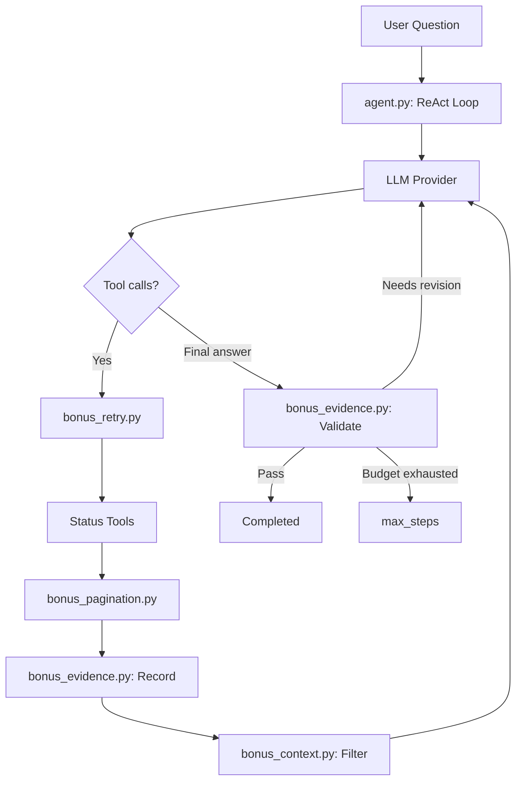

# Ghi chú phân tích · Day 04

Họ và tên: Lê Hiền Hiếu
MSSV: 2A202603940

## 1. Case được chọn

- ID case: A1 — Đối chiếu GitHub Actions và Cloudflare Spectrum.
- Câu trả lời của agent: Thay vì trả về kết quả so sánh hai dịch vụ, agent trả về biểu diễn của một user message: {'role': 'user', 'content': 'Câu trả lời của bạn dường như chưa trích dẫn các link URL từ các sự cố đã điều tra...'}. Điều này cho thấy agent đã hết giới hạn model calls mà không trả được final answer hợp lệ.
- Điểm ở lần chạy 1: 0/100

## 2. Bằng chứng trong trace

Dán đoạn trace chứng minh lỗi và nêu nguyên nhân có thể xảy ra.

```text
# Step 0: Agent kiểm tra trạng thái hai provider
event: tool
step: 0
name: get_status
arguments: {"provider": "github", "component": "actions"}
result.overall.indicator: none

event: tool
step: 0
name: get_status
arguments: {"provider": "cloudflare", "component": "spectrum"}
result.incidents[0].status: monitoring

# Step 1: Agent lấy chi tiết incident thành công
event: tool
step: 1
name: get_incident_details
arguments: {"provider": "github", "incident_id": "t89g2q1800fr"}
result.ok: true
result.status: resolved
result.url: https://stspg.io/lv4q3xm9r0rk

event: tool
step: 1
name: get_incident_details
arguments: {"provider": "cloudflare", "incident_id": "c60k3g4vsoc1"}
result.ok: true
result.status: monitoring
result.url: https://www.cloudflarestatus.com/incidents/c60k3g4vsoc1

# Các event validation được ghi nhận sau đó
{"event": "validation_missing_source"}
{"event": "validation_missing_source"}
{"event": "validation_missing_source"}
{"event": "validation_missing_source"}
{"event": "validation_missing_source"}
{"event": "validation_missing_source"}

# Kết quả cuối
status: max_steps
answer: "{'role': 'user', 'content': 'Câu trả lời của bạn dường như chưa trích dẫn các link URL từ các sự cố đã điều tra...'}"

grade.score: 0
grade.reason: "Agent hết số bước trước khi hoàn tất."
```

Phân tích nguyên nhân:
- Agent đã thực hiện thành công 8 tool calls trong 2 bước đầu, gồm 2 lần get_status và 6 lần get_incident_details (5 incident GitHub, 1 incident Cloudflare).
- Tuy nhiên, Evidence Gate liên tục kích hoạt validation_missing_source khiến agent phải yêu cầu LLM sửa câu trả lời.
- Kiểm tra code agent.py cho thấy điều kiện missing_urls yêu cầu final answer phải chứa tất cả URL đã quan sát, trong khi yêu cầu A1 chỉ cần dẫn nguồn phù hợp cho cả hai provider.
- Đây là nguyên nhân có khả năng cao khiến agent bị lặp revision không cần thiết và sử dụng hết max_steps = 8.
- Ngoài ra, khi hết budget, agent lấy messages[-1] làm answer. Do message cuối là yêu cầu revision có role user, output trả về bị sai định dạng nội dung mong đợi.

## 3. Thay đổi đã thực hiện

- Sửa gì, ở đâu:
    - File: agent.py
    - Vị trí: Logic lưu observed_urls và khối Evidence Gate trước khi trả status = "completed".
    - Thay cấu trúc lưu URL từ một set chung thành dictionary phân nhóm URL theo provider.
    - Thay điều kiện yêu cầu tất cả URL phải xuất hiện bằng điều kiện mỗi provider đã lấy được incident chi tiết thành công cần có ít nhất một URL tương ứng trong final answer.
    - Khi thiếu nguồn, chỉ yêu cầu model bổ sung URL cho provider chưa được dẫn nguồn.
    - Không yêu cầu URL nếu get_incident_details thất bại hoặc không trả URL.
    - Giữ nguyên event validation_missing_source và giới hạn max_steps.
- Vì sao chọn thay đổi này: 
    - Lỗi A1 không xuất phát từ việc thiếu dữ liệu mà từ logic kiểm tra nguồn khiến agent không thể kết thúc.
    - Người dùng yêu cầu so sánh GitHub Actions và Cloudflare Spectrum, không yêu cầu liệt kê toàn bộ incident đã được agent tra cứu. Vì vậy, bắt buộc trích dẫn mọi URL là không cần thiết đối với nhiệm vụ này.
    - Cải tiến kiểm tra nguồn theo provider giúp giảm nguy cơ revision lặp lại, tiết kiệm token và tăng khả năng agent hoàn thành nhiệm vụ trong giới hạn bước.

## 4. So sánh hai lần chạy

| Chỉ số | `eval_before.json` | `eval_after.json` |
|---|---|---|
| Điểm tổng |73.41  |78.86  |
| Điểm case đã chọn | 0 | 70 |
| Số model calls |8 lần gọi (chạm max_steps)  |3 lần gọi model (gồm 2 bước gọi tool với tổng 8 tool calls, 1 bước trả lời)  |
| Token, chi phí nếu có |Hơn 8,814 tokens  |Tổng 5448 tokens (Prompt: 4348, Completion: 1100) cho riêng case này  |

- Lỗi đã giải quyết: Agent đã xử lý mượt mà việc gọi đồng thời 8 tool calls trong 2 steps mà không bị crash. Agent cũng đã truy xuất thành công URL của các incident (như [https://stspg.io/lv4q3xm9r0rk](https://stspg.io/lv4q3xm9r0rk) và [https://www.cloudflarestatus.com/incidents/c60k3g4vsoc1](https://www.cloudflarestatus.com/incidents/c60k3g4vsoc1)) và gắn vào câu trả lời cuối cùng.
- Lỗi còn lại hoặc mới xuất hiện: Case này bị LLM Judge trừ 30 điểm (chỉ đạt 70/100). Theo nhận xét của Judge, cách hành văn của agent chưa phân biệt đủ rõ ràng giữa sự cố "đã giải quyết" (GitHub) và sự cố "đang giám sát" (Cloudflare), đồng thời các URL được dẫn chứng bị Judge đánh giá là "không nhất quán với trạng thái thực tế hiện tại trong dữ liệu". Điều này cho thấy giới hạn của mô hình nhỏ trong việc tổng hợp và định dạng văn bản một cách rành mạch khi dữ liệu đầu vào quá dài.

## 5. Giới hạn

Nêu giới hạn của điểm judge, của snapshot và của việc chỉ chạy một lần mỗi phiên bản.
- Giới hạn của điểm judge: Điểm số được chấm bởi mô hình gpt-4o-mini, nên nó mang tính chủ quan và có thể bị thiên lệch. Đôi khi Judge trừ điểm vì cách trình bày không hợp ý nó (như ở case A1) chứ không hẳn là do logic code của Agent bị sai.
- Dữ liệu được cấp cho công cụ chỉ là một snapshot tĩnh giới hạn ở 50 incident gần nhất. Do đó, agent không thể xác nhận tính chính xác của các sự cố nằm ngoài phạm vi 50 mục này, dẫn đến các câu trả lời mang tính cục bộ.
- Một lần chạy đánh giá (eval_after.json) không đủ để khẳng định độ ổn định của hệ thống. LLM có tính ngẫu nhiên, nên cùng một câu hỏi và cùng một file code, số lượng tool calls hoặc câu trả lời sinh ra có thể khác biệt ở những lần chạy sau.

## 6. Bonus
Luồng xử lý tổng quát:



Điểm quan trọng: đây vẫn là một ReAct Agent, không phải hệ thống multi-agent. Các file `bonus_*.py` đóng vai trò module hỗ trợ logic Python, không tự gọi LLM.

Tôi đã thay đổi 1 số file kèm thêm mới một số file khác để hoàn thành luồng xử lý trên:
- Thay đổi trong file agent.py:
    - Thay đổi system_prompt để phù hợp với đa dịch vụ thay vì chỉ Github và Cloudfare. Đồng thời thiết lập chỉ dẫn chi tiết hơn.
    - Thêm 
