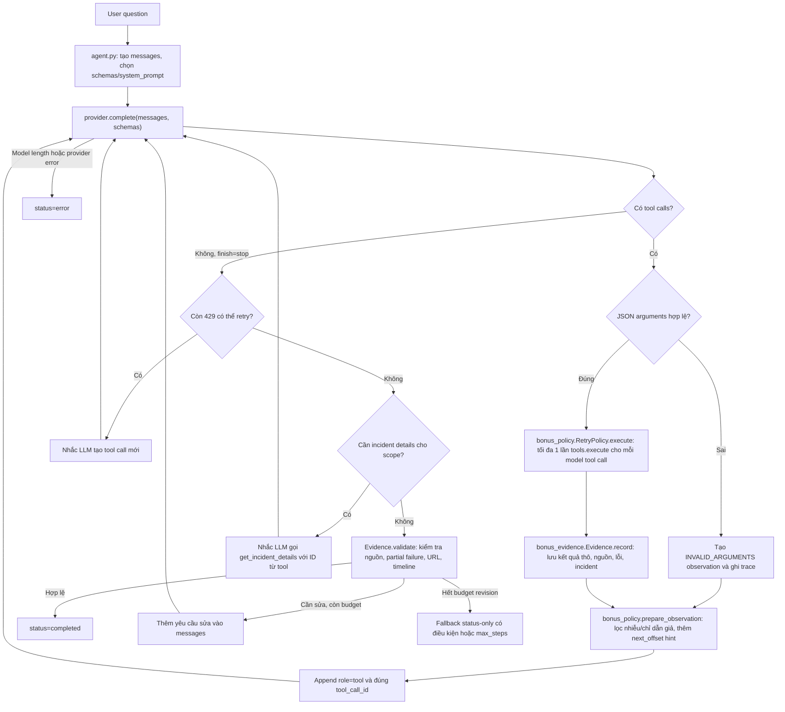

# Ghi chú phân tích · Day 04

Họ và tên: Lê Hiền Hiếu
MSSV: 2A202603940

## 1. Case được chọn

- ID case: A1 — Đối chiếu GitHub Actions và Cloudflare Spectrum.
- Câu trả lời của agent: Thay vì trả về kết quả so sánh hai dịch vụ, agent trả về biểu diễn của một user message: {'role': 'user', 'content': 'Câu trả lời của bạn dường như chưa trích dẫn các link URL từ các sự cố đã điều tra...'}. Điều này cho thấy agent đã hết giới hạn model calls mà không trả được final answer hợp lệ.
- Điểm ở lần chạy 1: 0/100

## 2. Bằng chứng trong trace

Dán đoạn trace chứng minh lỗi và nêu nguyên nhân có thể xảy ra.

```text
# Step 0: Agent kiểm tra trạng thái hai provider
event: tool
step: 0
name: get_status
arguments: {"provider": "github", "component": "actions"}
result.overall.indicator: none

event: tool
step: 0
name: get_status
arguments: {"provider": "cloudflare", "component": "spectrum"}
result.incidents[0].status: monitoring

# Step 1: Agent lấy chi tiết incident thành công
event: tool
step: 1
name: get_incident_details
arguments: {"provider": "github", "incident_id": "t89g2q1800fr"}
result.ok: true
result.status: resolved
result.url: https://stspg.io/lv4q3xm9r0rk

event: tool
step: 1
name: get_incident_details
arguments: {"provider": "cloudflare", "incident_id": "c60k3g4vsoc1"}
result.ok: true
result.status: monitoring
result.url: https://www.cloudflarestatus.com/incidents/c60k3g4vsoc1

# Các event validation được ghi nhận sau đó
{"event": "validation_missing_source"}
{"event": "validation_missing_source"}
{"event": "validation_missing_source"}
{"event": "validation_missing_source"}
{"event": "validation_missing_source"}
{"event": "validation_missing_source"}

# Kết quả cuối
status: max_steps
answer: "{'role': 'user', 'content': 'Câu trả lời của bạn dường như chưa trích dẫn các link URL từ các sự cố đã điều tra...'}"

grade.score: 0
grade.reason: "Agent hết số bước trước khi hoàn tất."
```

Phân tích nguyên nhân:
- Agent đã thực hiện thành công 8 tool calls trong 2 bước đầu, gồm 2 lần get_status và 6 lần get_incident_details (5 incident GitHub, 1 incident Cloudflare).
- Tuy nhiên, Evidence Gate liên tục kích hoạt validation_missing_source khiến agent phải yêu cầu LLM sửa câu trả lời.
- Kiểm tra code agent.py cho thấy điều kiện missing_urls yêu cầu final answer phải chứa tất cả URL đã quan sát, trong khi yêu cầu A1 chỉ cần dẫn nguồn phù hợp cho cả hai provider.
- Đây là nguyên nhân có khả năng cao khiến agent bị lặp revision không cần thiết và sử dụng hết max_steps = 8.
- Ngoài ra, khi hết budget, agent lấy messages[-1] làm answer. Do message cuối là yêu cầu revision có role user, output trả về bị sai định dạng nội dung mong đợi.

## 3. Thay đổi đã thực hiện

- Sửa gì, ở đâu:
    - File: agent.py
    - Vị trí: Logic lưu observed_urls và khối Evidence Gate trước khi trả status = "completed".
    - Thay cấu trúc lưu URL từ một set chung thành dictionary phân nhóm URL theo provider.
    - Thay điều kiện yêu cầu tất cả URL phải xuất hiện bằng điều kiện mỗi provider đã lấy được incident chi tiết thành công cần có ít nhất một URL tương ứng trong final answer.
    - Khi thiếu nguồn, chỉ yêu cầu model bổ sung URL cho provider chưa được dẫn nguồn.
    - Không yêu cầu URL nếu get_incident_details thất bại hoặc không trả URL.
    - Giữ nguyên event validation_missing_source và giới hạn max_steps.
- Vì sao chọn thay đổi này: 
    - Lỗi A1 không xuất phát từ việc thiếu dữ liệu mà từ logic kiểm tra nguồn khiến agent không thể kết thúc.
    - Người dùng yêu cầu so sánh GitHub Actions và Cloudflare Spectrum, không yêu cầu liệt kê toàn bộ incident đã được agent tra cứu. Vì vậy, bắt buộc trích dẫn mọi URL là không cần thiết đối với nhiệm vụ này.
    - Cải tiến kiểm tra nguồn theo provider giúp giảm nguy cơ revision lặp lại, tiết kiệm token và tăng khả năng agent hoàn thành nhiệm vụ trong giới hạn bước.

## 4. So sánh hai lần chạy

| Chỉ số | `eval_before.json` | `eval_after.json` |
|---|---|---|
| Điểm tổng |73.41  |78.86  |
| Điểm case đã chọn | 0 | 70 |
| Số model calls |8 lần gọi (chạm max_steps)  |3 lần gọi model (gồm 2 bước gọi tool với tổng 8 tool calls, 1 bước trả lời)  |
| Token, chi phí nếu có |Hơn 8,814 tokens  |Tổng 5448 tokens (Prompt: 4348, Completion: 1100) cho riêng case này  |

- Lỗi đã giải quyết: Agent đã xử lý mượt mà việc gọi đồng thời 8 tool calls trong 2 steps mà không bị crash. Agent cũng đã truy xuất thành công URL của các incident (như [https://stspg.io/lv4q3xm9r0rk](https://stspg.io/lv4q3xm9r0rk) và [https://www.cloudflarestatus.com/incidents/c60k3g4vsoc1](https://www.cloudflarestatus.com/incidents/c60k3g4vsoc1)) và gắn vào câu trả lời cuối cùng.
- Lỗi còn lại hoặc mới xuất hiện: Case này bị LLM Judge trừ 30 điểm (chỉ đạt 70/100). Theo nhận xét của Judge, cách hành văn của agent chưa phân biệt đủ rõ ràng giữa sự cố "đã giải quyết" (GitHub) và sự cố "đang giám sát" (Cloudflare), đồng thời các URL được dẫn chứng bị Judge đánh giá là "không nhất quán với trạng thái thực tế hiện tại trong dữ liệu". Điều này cho thấy giới hạn của mô hình nhỏ trong việc tổng hợp và định dạng văn bản một cách rành mạch khi dữ liệu đầu vào quá dài.

## 5. Giới hạn

Nêu giới hạn của điểm judge, của snapshot và của việc chỉ chạy một lần mỗi phiên bản.
- Giới hạn của điểm judge: Điểm số được chấm bởi mô hình gpt-4o-mini, nên nó mang tính chủ quan và có thể bị thiên lệch. Đôi khi Judge trừ điểm vì cách trình bày không hợp ý nó (như ở case A1) chứ không hẳn là do logic code của Agent bị sai.
- Dữ liệu được cấp cho công cụ chỉ là một snapshot tĩnh giới hạn ở 50 incident gần nhất. Do đó, agent không thể xác nhận tính chính xác của các sự cố nằm ngoài phạm vi 50 mục này, dẫn đến các câu trả lời mang tính cục bộ.
- Một lần chạy đánh giá (eval_after.json) không đủ để khẳng định độ ổn định của hệ thống. LLM có tính ngẫu nhiên, nên cùng một câu hỏi và cùng một file code, số lượng tool calls hoặc câu trả lời sinh ra có thể khác biệt ở những lần chạy sau.

## 6. Bonus
### 6.1. Mục tiêu và phạm vi

Bài bonus mở rộng từ hai công cụ của bài chính (`get_status`, `get_incident_details`) sang năm status API (GitHub, Cloudflare, Vercel, npm, DigitalOcean) và công cụ `get_incident_details` hỗ trợ phân trang. Mục tiêu không phải xây multi-agent, mà vẫn duy trì **một ReAct Agent**: LLM chọn lời gọi công cụ; code Python quản lý vòng lặp, lỗi, giới hạn bước, độ tin cậy của quan sát và kiểm tra bằng chứng.

### 6.2. Sơ đồ luồng xử lý hiện tại



**Một model step là một lần gọi `provider.complete()`**, không phải một tool call. Nếu model yêu cầu nhiều tools trong một response, agent xử lý hết các tool calls và trả lại từng observation tương ứng trước khi gọi model lần tiếp theo.

### 6.3. Những thay đổi trong `agent.py` so với bản bài chính

| Thành phần | Bản `agent.py` ban đầu | Bản refactor | Mục đích |
|---|---|---|---|
| Danh sách tools | Mặc định dùng `SCHEMAS` của `status_tools.py` | Ưu tiên `tools.schemas`, fallback `SCHEMAS` | Một agent dùng được cả hai bộ tools |
| System prompt | Một `SYSTEM_PROMPT` mặc định | Ưu tiên `tools.system_prompt`; bổ sung `BONUS_PROMPT` khi nhận diện bonus | Chỉ dẫn phù hợp contract mới; không hard-code incident ID |
| ReAct loop | `provider.complete()` → tools → final | Vẫn một loop, giữ nguyên assistant message và `tool_call_id` | Tuân thủ Bài 1 GUIDE, không biến thành multi-agent |
| Xử lý lỗi | Lỗi JSON và tool được ghi nhận; lỗi provider xử lý hạn chế | Xử lý JSON không hợp lệ, ngoại lệ provider/tool, `finish=length`, trả observation | Tránh crash và cho model điều chỉnh |
| Retry | Không có quản lý retry 429 theo budget | `RetryPolicy` giữ counter và `Retry-After`; guard nhắc model gọi lại | B3/B4/B10: thử lại có giới hạn, tránh coi 429 là outage |
| Pagination | Core tools trả một phần updates, không có offset | Model được gửi `next_offset` và hint gọi trang kế tiếp | B2: đọc timeline nhiều bước khi cần |
| Context | Chuyển gần như nguyên result cho model | Lọc dữ liệu nhiễu và chỉ dẫn giả trước khi gửi observation | B6/B7: giảm noise và rủi ro prompt injection |
| Evidence Gate | `observed_urls` là một set chung; từng yêu cầu sửa có thể lặp | `Evidence` quản lý nguồn theo provider, URLs incident, lỗi, timeline | Không bắt dẫn tất cả URLs; giảm vòng lặp như A1/B4 |
| Pre-final guard | Không có | Nhắc retry hoặc lấy chi tiết incident trước final | Không kết luận quá sớm như B6/B10 |
| Kết quả khi hết bước | Có thể vô tình lấy nội dung user-message cuối | Giữ `last_answer`; trả `max_steps` hoặc fallback status-only | Không trả nhầm yêu cầu revision thành câu trả lời |

### 6.4. Hai module được thêm vào và trách nhiệm

**`bonus_policy.py` — Chính sách thực thi và quan sát:**

- `RetryPolicy`: xác định đích gọi `(tool_name, provider)`, ghi số lần 429, giới hạn tối đa ba lần **gọi thực tế** trong một chuỗi 429 liên tiếp, tôn trọng `Retry-After` trong budget. Mỗi tool call do model gửi chỉ thực thi tối đa một lần; lỗi được đưa lại cho model thay vì retry ngầm.
- `prepare_observation`: loại trường `distractors` của fixture bonus khi không mang bằng chứng, giảm danh sách quá dài và loại các dòng giống prompt injection. Trace vẫn lưu `result` gốc; chỉ observation gửi cho LLM được lọc.
- Với kết quả `get_incident_details` có `next_offset`, bổ sung gợi ý phân trang. Module **không tự đọc trang tiếp theo**.

**`bonus_evidence.py` — Nguồn sự thật và Evidence Gate:**

- `Evidence.record`: lưu status snapshot thành công theo provider, lỗi status chưa phục hồi, các URL incident đọc thành công, incident đã xem và timeline còn trang tiếp.
- `Evidence.missing_details`: nhận diện yêu cầu so sánh phạm vi/tác động incident dựa trên từ khóa, chọn ID từ kết quả status tool để agent nhắc model tra chi tiết.
- `Evidence.validate`: kiểm tra có ít nhất một incident URL đã xác minh cho mỗi provider có chi tiết incident; phát hiện URL incident chưa được công cụ xác nhận, thiếu nguồn khi câu hỏi yêu cầu, khẳng định hoạt động khi tool lỗi, và tuyên bố đã đọc hết timeline không có bằng chứng.
- `Evidence.summary`: dựng một báo cáo **status-only** có căn cứ khi LLM liên tục thất bại ở bước sửa; không áp dụng để thay thế phân tích phạm vi incident.

### 6.5. Kiểm thử và kết quả đánh giá bonus
- **Đối chiếu GUIDE:** `run_agent(question, provider, tools, max_steps=6)` vẫn là entry point; dùng `tools.schemas`/`tools.system_prompt` khi có, giữ nguyên assistant message và `tool_call_id`, xử lý mọi tool call của một model step, ghi `trace` và `usage`, xử lý `INVALID_ARGUMENTS`, lỗi tools/provider và giới hạn `max_steps`.
- **Kiểm thử offline đã ghi nhận:** 3/3 unit tests bonus do bài lab cung cấp và 11/11 regression tests bổ sung PASS. Các kiểm thử này xác nhận luồng xử lý mô phỏng, không thay thế đánh giá bằng LLM thật.
- **Kết quả từ `eval_bonus(1).json`:** **74,5/100 tương đương 11,17/15 điểm bonus tham khảo**; đủ **10/10** case được chấm, không có case `unscored`. Cấu hình: agent và judge đều dùng `gpt-4o-mini`, `max_steps=16`, dataset `bonus`.

| Case | B1 | B2 | B3 | B4 | B5 | B6 | B7 | B8 | B9 | B10 |
|---|---:|---:|---:|---:|---:|---:|---:|---:|---:|---:|
| Điểm | 85 | 85 | 20 | 75 | 100 | 80 | 100 | 100 | 35 | 65 |

- Những hành vi đã quan sát trực tiếp trong trace: B2 phân trang qua ba model steps; B4 dừng ở ba lần gọi Vercel thực tế; B5 phục hồi sau `INVALID_ARGUMENTS`; B6 điều tra thêm incident details cho cả Vercel và npm; B7 chống chỉ dẫn giả trong dữ liệu; B10 gọi lại Vercel sau 429. Tuy nhiên B3 và B9 vẫn có điểm thấp nên chưa thể kết luận agent xử lý mọi tình huống tốt.
- Kết quả trên thuộc **lần chạy đính kèm cho phiên bản bonus hiện tại**. Khi so sánh các lần chạy, cần giữ cùng model, judge, dataset, `max_steps` và đối chiếu cả trace. Chưa có kết quả đầy đủ 22 case bài chính của chính phiên bản này trong tài liệu, nên chưa khẳng định bài chính không bị ảnh hưởng.

Lệnh kiểm tra trong repo đầy đủ:

```bash
python -m py_compile agent.py bonus_policy.py bonus_evidence.py
python -m unittest discover -s tests -v
python -m unittest discover -s bonus -p 'test_*.py' -v
python evals/run_evals.py --bonus --output eval_bonus.json
```

### 6.6. Giới hạn, rủi ro và hướng cải tiến

**1. Retry và xử lý lỗi.** Khi status tool trả `RATE_LIMITED`, agent đưa lỗi về LLM dưới dạng observation. LLM có thể sinh tool call mới; `RetryPolicy` giới hạn tối đa **3 lần thực thi** trong một chuỗi 429 liên tiếp, đồng thời đọc `Retry-After` và chỉ chờ trong budget cho phép. Khi lỗi kéo dài, agent phải kết luận **chưa xác minh được** provider đó, không coi 429 là outage và vẫn báo những provider tra cứu thành công. Trong **B4 (75/100)**, Vercel trả 429 ba lần, có event `retry_exhausted`, GitHub vẫn được báo cáo có nguồn. Trong **B10 (65/100)**, event `retry_reminder` giúp model gọi Vercel lại và thu được kết quả. Hạn chế còn lại là **thực thi retry đúng chưa bảo đảm trình bày đúng**: ở **B3 (20/100)**, Vercel phục hồi sau lần gọi thứ hai nhưng câu trả lời cuối bỏ qua thông tin đã gặp 429 lần đầu. Hướng cải tiến là kiểm tra câu trả lời có mô tả lỗi ban đầu và kết quả retry khi câu hỏi yêu cầu, thay vì chỉ kiểm tra trạng thái cuối; tiếp tục kiểm thử thời gian chờ `Retry-After` ở chế độ live.

**2. Pagination của incident timeline.** `get_incident_details` trả các `updates` theo trang, cùng `next_offset`; `bonus_policy.py` chỉ bổ sung gợi ý phân trang, **không tự gọi trang tiếp theo**. LLM quyết định gọi công cụ ở model step mới khi cần tìm các cập nhật cũ hơn. Trong **B2 (85/100)**, trace ghi ba lần gọi với offset **0 → 2 → 4**; thông báo về GitHub-connected builds nằm ở trang có offset 2. Điều này xác nhận khả năng truy xuất dữ liệu nằm sâu trong timeline nhưng cũng cho thấy model có thể gọi thêm trang chưa thật sự cần thiết. Rủi ro là mô hình dừng quá sớm, đọc thiếu update hoặc khẳng định đã đọc toàn bộ timeline khi `next_offset` vẫn còn. Hướng cải tiến là dừng khi đã thu được bằng chứng đủ trả lời, theo dõi những trang đã xem theo từng incident và nêu rõ phần timeline chưa đọc. Kiểm tra URL cũng cần phân biệt link incident được công cụ xác minh với URL bên ngoài chỉ được **nhắc đến trong body** của update: B2 từng xuất hiện `validation_failed` do link GitHub được dẫn từ nội dung update mà chưa được công cụ xác minh trực tiếp.

**3. Context và độ tin cậy của tool output.** `bonus_policy.prepare_observation()` loại trường `distractors`, rút ngắn danh sách quá dài và lọc những dòng có dấu hiệu prompt injection **trước khi chuyển observation cho LLM**; kết quả tool gốc vẫn được lưu trong trace để kiểm tra. Trong **B6 (80/100)**, status Vercel chứa **160 distractors**, nhưng agent vẫn chọn được incident Vercel Builds và npm publishing, sau đó gọi `get_incident_details` cho cả hai. Trong **B7 (100/100)**, câu trả lời không làm theo chỉ dẫn giả của tool output. Giới hạn là phương pháp lọc theo trường dữ liệu, từ khóa và biểu thức chính quy mang tính heuristic: có thể loại nhầm bằng chứng liên quan hoặc bỏ sót kiểu prompt injection mới; dữ liệu dài vẫn tốn ngữ cảnh. Hướng cải tiến là ưu tiên chọn lọc theo provider, component, incident ID và câu hỏi, giữ metadata về dữ liệu bị lược bỏ và bổ sung kiểm thử với dữ liệu nhiễu đa dạng hơn.

**4. Các giới hạn còn lại.** Trong **B9 (35/100)**, agent vẫn gọi cả năm status tools dù câu hỏi nhắm đến Linear và Slack — hai provider không được hỗ trợ; việc này tốn model/tool calls nhưng không tạo được bằng chứng phù hợp. Cần cải thiện **tool selection**: nhận diện provider được yêu cầu, đối chiếu với tool schemas trước khi gọi và trả lời thẳng rằng chưa thể xác minh nếu không có công cụ tương ứng. Ngoài ra, Evidence Gate vẫn dựa một phần vào kiểm tra URL/regex nên không bảo đảm mọi nhận định đều đúng; cơ chế fallback status-only khi hết lượt sửa có thể bỏ sót ý chính của câu hỏi. Dữ liệu snapshot tại `captured_at` không chứng minh trạng thái live; danh sách incidents có giới hạn nên kết quả rỗng không chứng minh sự cố không tồn tại. Cuối cùng, LLM judge có thể chấm không nhất quán và một lần eval chưa phản ánh độ ổn định. Cần chạy thêm nhiều lần với cùng cấu hình và chạy lại bộ 22 case bài chính trước khi kết luận chất lượng tổng thể.


